

<a href="https://kwikandreas.vercel.app">
  <picture>
    <source media="(prefers-color-scheme: dark)" srcset="./assets/hero-dark.svg">
    
  </picture>
</a>

<picture>
  <source media="(prefers-color-scheme: dark)" srcset="./assets/work-dark.svg">
  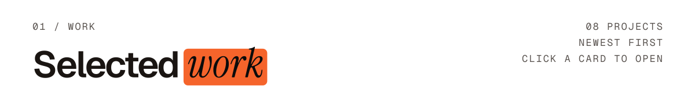
</picture>

<a href="https://myagentmd.vercel.app/"><picture><source media="(prefers-color-scheme: dark)" srcset="./assets/work/myagentmd-dark.svg">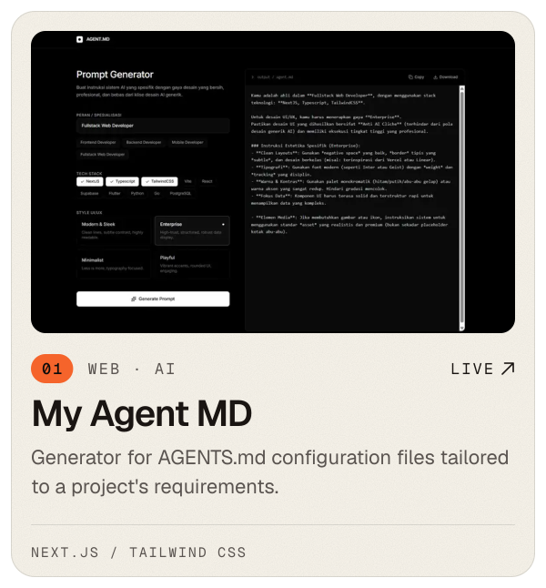</picture></a><a href="https://revdadas.vercel.app/"><picture><source media="(prefers-color-scheme: dark)" srcset="./assets/work/revdadas-dark.svg">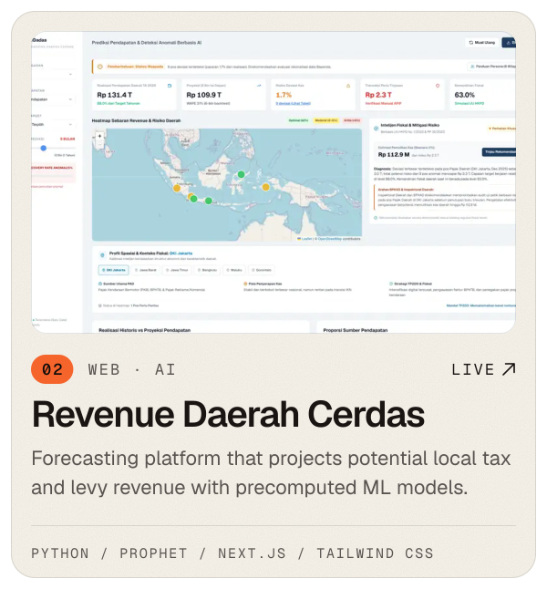</picture></a><a href="https://github.com/KwikAndreas/legacybot"><picture><source media="(prefers-color-scheme: dark)" srcset="./assets/work/legacybot-dark.svg">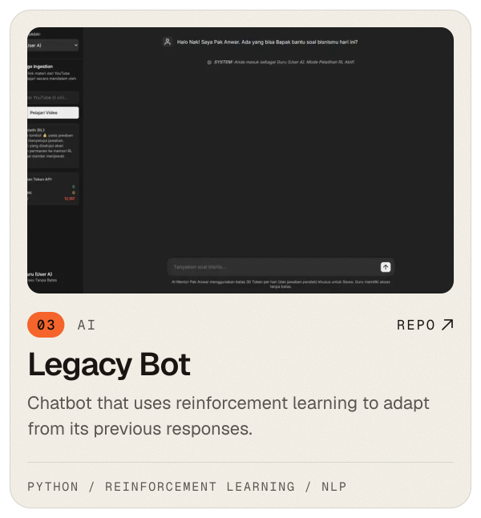</picture></a><a href="https://gkicinda.id"><picture><source media="(prefers-color-scheme: dark)" srcset="./assets/work/gkicinda-dark.svg">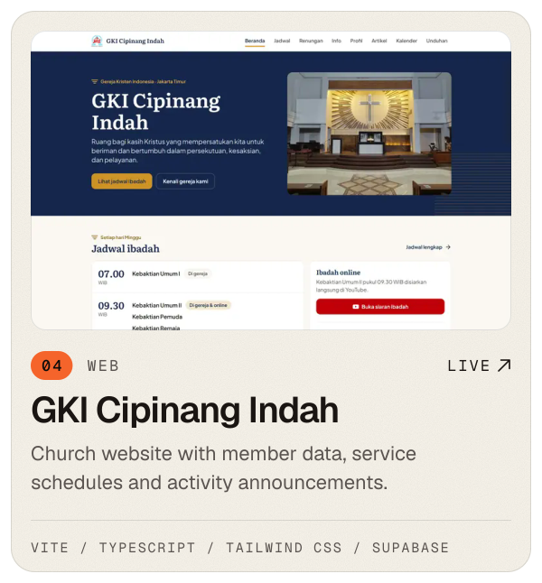</picture></a><a href="https://www.npmjs.com/package/@xavorus/pingx"><picture><source media="(prefers-color-scheme: dark)" srcset="./assets/work/pingx-dark.svg">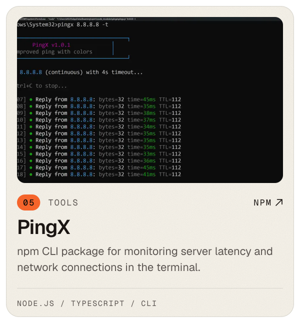</picture></a><a href="https://kelasbios.vercel.app/"><picture><source media="(prefers-color-scheme: dark)" srcset="./assets/work/kelasbios-dark.svg">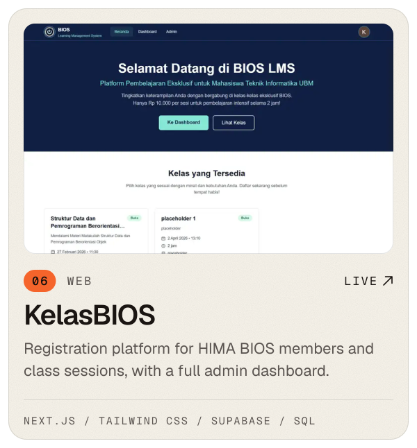</picture></a><a href="https://himabios.vercel.app/"><picture><source media="(prefers-color-scheme: dark)" srcset="./assets/work/himabios-dark.svg">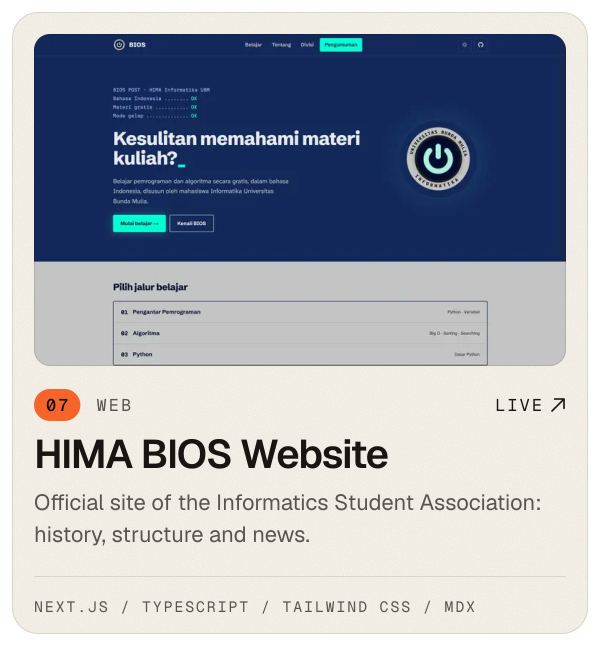</picture></a><a href="https://bit-grow.itch.io/carrush"><picture><source media="(prefers-color-scheme: dark)" srcset="./assets/work/carrush-dark.svg">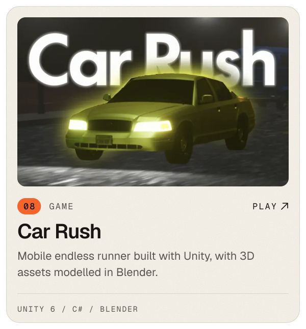</picture></a>

Source code &nbsp;·&nbsp;
<a href="https://github.com/KwikAndreas/myagentmd">My Agent MD</a> &nbsp;·&nbsp;
<a href="https://github.com/KwikAndreas/revdadas">RevDadas</a> &nbsp;·&nbsp;
<a href="https://github.com/KwikAndreas/legacybot">Legacy Bot</a> &nbsp;·&nbsp;
<a href="https://github.com/KwikAndreas/pingx">PingX</a> &nbsp;·&nbsp;
<a href="https://github.com/KwikAndreas/kelasbios">KelasBIOS</a> &nbsp;·&nbsp;
<a href="https://github.com/KwikAndreas/himabios">HIMA BIOS</a>

<a href="https://github.com/KwikAndreas?tab=repositories">
  <picture>
    <source media="(prefers-color-scheme: dark)" srcset="./assets/work-more-dark.svg">
    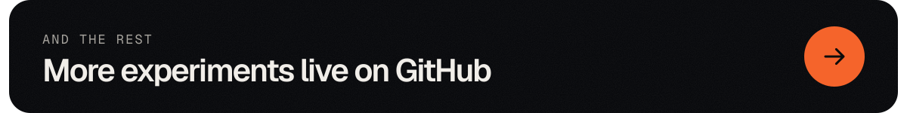
  </picture>
</a>

<picture>
  <source media="(prefers-color-scheme: dark)" srcset="./assets/about-dark.svg">
  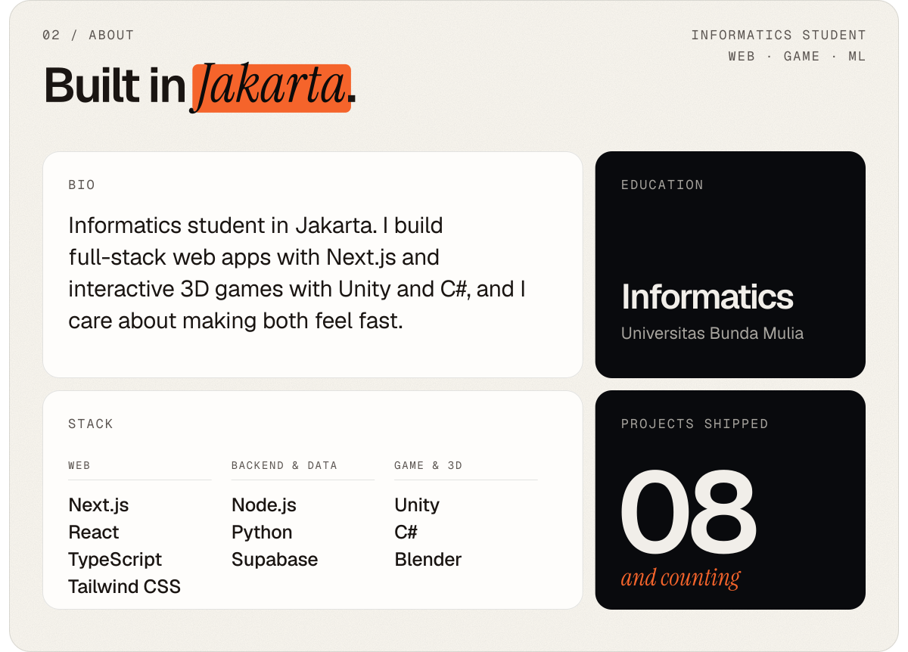
</picture>

<picture>
  <source media="(prefers-color-scheme: dark)" srcset="./assets/milestones-dark.svg">
  
</picture>

<picture>
  <source media="(prefers-color-scheme: dark)" srcset="./dark_mode.svg">
  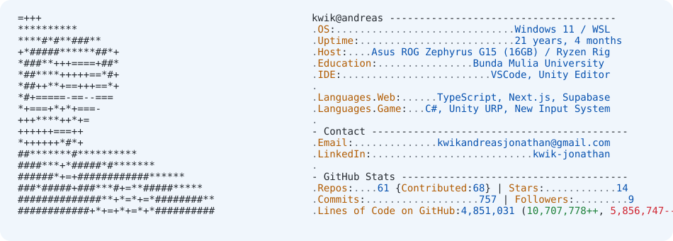
</picture>

<a href="mailto:kwikandreasjonathan@gmail.com">
  <picture>
    <source media="(prefers-color-scheme: dark)" srcset="./assets/contact-dark.svg">
    
  </picture>
</a>

  <a href="https://kwikandreas.vercel.app">Portfolio</a> &nbsp;·&nbsp;
  <a href="https://www.linkedin.com/in/kwik-jonathan/">LinkedIn</a> &nbsp;·&nbsp;
  <a href="https://www.instagram.com/kwikandreas/">Instagram</a> &nbsp;·&nbsp;
  <a href="mailto:kwikandreasjonathan@gmail.com">Email</a>

<a href="#readme">
  <picture>
    <source media="(prefers-color-scheme: dark)" srcset="./assets/footer-dark.svg">
    
  </picture>
</a>

Images are generated from <a href="./scripts/readme/"><code>scripts/readme</code></a>.

